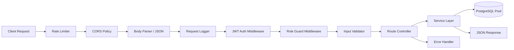
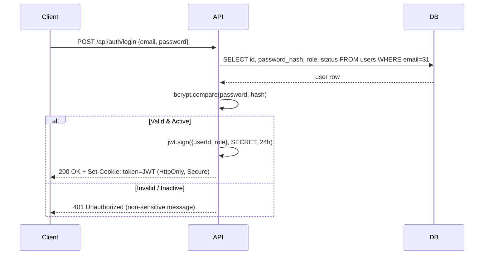
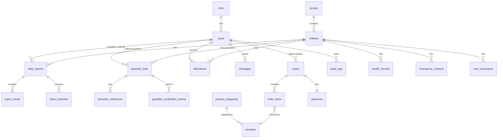
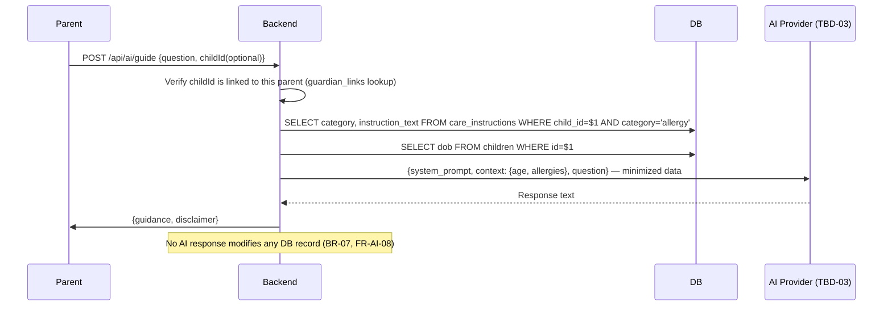

# Ankelba — Backend Architecture Plan v2.0
**SRS v1.0 · Stack: Node.js / Express · PostgreSQL · React (frontend)**  
**Updated:** Database Normalization (3NF/BCNF) + Query Optimization Strategy

---

> [!IMPORTANT]
> All design decisions trace back to SRS requirements. Items marked **TBD** block finalisation until advisor confirms the relevant open question.  
> 🔧 **NEW in v2.0:** Sections 5–6 fully rewritten with normalized schema + complete indexing and query optimization plan.

---

## 1. Tech Stack

| Layer | Technology | Reason |
|---|---|---|
| Runtime | Node.js (LTS) | Proposed in SRS SI-02 |
| Framework | Express.js | Lightweight, well-documented |
| Database | PostgreSQL | Mandated by SRS SI-01 |
| ORM / Query | **Knex.js** (preferred over Sequelize) | Raw-SQL control for optimized queries; migration support |
| Auth | JWT (HTTP-only cookie) | Stateless, secure, no plain-text passwords (NFR-SEC-03) |
| Password Hashing | bcrypt | Industry standard |
| File Storage | Local disk → S3-compatible (future) | Optional photos (TBD-04) |
| AI Integration | External AI API (TBD-03) | FR-AI-01 |
| Payment | Chapa API + webhook (TBD-02) | SI-04, SI-05 |
| Environment Config | dotenv | Keeps secrets server-side (NFR-SEC-05) |
| Validation | Joi or Zod | NFR-USA-03, FR-DB-03 |
| Logging | Winston / Morgan | NFR-MNT-03 |
| Version Control | Git | NFR-MNT-02 |
| **Connection Pool** | **pg (node-postgres) pool** | Reuse DB connections; avoid per-request overhead |

> **Why Knex over Sequelize for performance:**  
> Knex writes SQL you can read and optimize. Sequelize hides queries behind ORM magic, often generating N+1 patterns and unneeded JOINs. For a data-sensitive student project under advisor review, readable, optimized SQL is preferable.

---

## 2. Top-Level Folder Structure

```
ankelba-backend/
├── src/
│   ├── config/          # DB connection pool, env, logger
│   ├── middleware/       # auth, rbac, error handler, validator
│   ├── modules/
│   │   ├── auth/         # login, logout, session
│   │   ├── users/        # account CRUD (admin)
│   │   ├── children/     # child profiles, guardian links
│   │   ├── attendance/   # check-in, check-out, absence
│   │   ├── reports/      # daily activity reports
│   │   ├── health/       # health observations & incidents
│   │   ├── communication/# messages, announcements, alerts
│   │   ├── ai-guide/     # AI parent guide integration
│   │   ├── biometric/    # guardian enrollment & verification
│   │   ├── store/        # products, cart, orders
│   │   ├── payments/     # payment records, webhook handler
│   │   ├── events/       # daycare events calendar
│   │   └── audit/        # audit log
│   ├── db/
│   │   ├── migrations/   # versioned schema changes (run in order)
│   │   └── seeds/        # test data (NFR-TST-02)
│   └── app.js            # Express app bootstrap
├── .env                  # Never committed to git
└── server.js             # Entry point
```

---

## 3. Request Lifecycle (Middleware Chain)



**Key rules:**
- `AUTH` → verifies JWT from `HttpOnly` cookie; rejects expired/invalid sessions (FR-UAM-07, NFR-SEC-07)
- `RBAC` → checks `req.user.role` against route's `allowedRoles[]` array (FR-UAM-03, NFR-SEC-02)
- `VAL` → schema-validates body/params before hitting the controller (NFR-USA-03)
- `ERR` → centralised error handler; never leaks stack traces to clients (NFR-MNT-03)

---

## 4. Authentication & Session Design



- **Logout:** `POST /api/auth/logout` → clears the cookie (FR-UAM-07)
- **Protected routes:** middleware reads cookie, verifies JWT, attaches `req.user`
- Passwords stored as **bcrypt hash only** — never plain text (NFR-SEC-03)
- Login query uses the `users.email` unique index — single row lookup, no full scan

---

## 5. Database Schema — Normalized (3NF / BCNF)

> [!IMPORTANT]
> **Normalization goals:** eliminate data redundancy, prevent update anomalies, ensure every non-key column depends on the whole key and nothing but the key. All 19 SRS entities (§6.1) are mapped below to 3NF-compliant tables.  
> **Constraint rules applied throughout:**
> - `NOT NULL` on every mandatory column
> - `UNIQUE` constraints where identity must be enforced
> - `CHECK` constraints to enforce ENUM-equivalent values at the DB level (more portable than PG native ENUM which requires migration to add values)
> - `ON DELETE` rules on every foreign key (documented per table)
> - All timestamps use `TIMESTAMPTZ` (timezone-aware)

---

### 5.1 Lookup / Reference Tables

These tables are extracted to support normalization — they eliminate repeated string literals and allow future extensibility without migrations.

```sql
-- roles: avoids hard-coded role strings scattered in app code
CREATE TABLE roles (
  id   SMALLINT PRIMARY KEY,
  name VARCHAR(20) NOT NULL UNIQUE  -- 'admin', 'caregiver', 'parent'
);

-- product_categories: extracted from products table (was inline string in v1)
-- Normalization: category name is a repeating attribute; extracting prevents
-- update anomalies (e.g., renaming "Snacks" requires one row update, not many)
CREATE TABLE product_categories (
  id   SERIAL PRIMARY KEY,
  name VARCHAR(50) NOT NULL UNIQUE
);

-- groups / classes (unchanged)
CREATE TABLE groups (
  id          SERIAL PRIMARY KEY,
  name        VARCHAR(100) NOT NULL UNIQUE,
  description TEXT
);
```

---

### 5.2 Core Identity Tables

```sql
-- users
-- Normalization: role stored as FK to roles table (not repeated string)
-- BCNF: {email} → {name, password_hash, role_id, status} — no partial deps
CREATE TABLE users (
  id            SERIAL PRIMARY KEY,
  name          VARCHAR(150) NOT NULL,
  email         VARCHAR(255) NOT NULL UNIQUE,
  password_hash VARCHAR(255) NOT NULL,
  role_id       SMALLINT     NOT NULL REFERENCES roles(id),
  status        VARCHAR(20)  NOT NULL DEFAULT 'active'
                CHECK (status IN ('active','inactive')),
  created_at    TIMESTAMPTZ  NOT NULL DEFAULT NOW(),
  updated_at    TIMESTAMPTZ  NOT NULL DEFAULT NOW()
);

-- children
-- Normalization: group and caregiver are separate entities → FK only, no duplication
CREATE TABLE children (
  id                SERIAL PRIMARY KEY,
  full_name         VARCHAR(150) NOT NULL,
  dob               DATE         NOT NULL,
  gender            VARCHAR(10)  CHECK (gender IN ('male','female','other')),
  photo_url         TEXT,
  group_id          INTEGER      REFERENCES groups(id) ON DELETE SET NULL,
  caregiver_id      INTEGER      REFERENCES users(id)  ON DELETE SET NULL,
  enrollment_status VARCHAR(20)  NOT NULL DEFAULT 'active'
                    CHECK (enrollment_status IN ('active','inactive','waitlist')),
  created_at        TIMESTAMPTZ  NOT NULL DEFAULT NOW()
);

-- emergency_contacts
-- 3NF: each contact attribute depends only on contact PK, not on child attributes
CREATE TABLE emergency_contacts (
  id           SERIAL PRIMARY KEY,
  child_id     INTEGER      NOT NULL REFERENCES children(id) ON DELETE CASCADE,
  name         VARCHAR(150) NOT NULL,
  relationship VARCHAR(80)  NOT NULL,
  phone        VARCHAR(30)  NOT NULL
);

-- care_instructions
-- Normalized: category extracted as a constrained column; one row per instruction
-- This was previously a single TEXT blob in v1 — splitting allows per-category querying
CREATE TABLE care_instructions (
  id               SERIAL PRIMARY KEY,
  child_id         INTEGER     NOT NULL REFERENCES children(id) ON DELETE CASCADE,
  category         VARCHAR(50) NOT NULL
                   CHECK (category IN ('allergy','dietary','medical_note','general')),
  instruction_text TEXT        NOT NULL
);

-- guardian_links
-- Junction table (child ↔ user many-to-many) — BCNF compliant
-- UNIQUE on (child_id, user_id) prevents duplicate links
CREATE TABLE guardian_links (
  id                SERIAL      PRIMARY KEY,
  child_id          INTEGER     NOT NULL REFERENCES children(id) ON DELETE CASCADE,
  user_id           INTEGER     NOT NULL REFERENCES users(id)    ON DELETE CASCADE,
  relationship      VARCHAR(80) NOT NULL,
  pickup_authorized BOOLEAN     NOT NULL DEFAULT FALSE,
  created_by        INTEGER     NOT NULL REFERENCES users(id),
  created_at        TIMESTAMPTZ NOT NULL DEFAULT NOW(),
  UNIQUE (child_id, user_id)
);
```

---

### 5.3 Attendance

```sql
-- attendance
-- v1 issue: verification_method was in this table — removed to separate concern
-- verification is now ONLY recorded in guardian_verification_events (§5.6)
-- which avoids NULL-heavy columns on non-checkout records
CREATE TABLE attendance (
  id           SERIAL PRIMARY KEY,
  child_id     INTEGER     NOT NULL REFERENCES children(id) ON DELETE RESTRICT,
  recorded_by  INTEGER     NOT NULL REFERENCES users(id)    ON DELETE RESTRICT,
  event_type   VARCHAR(20) NOT NULL
               CHECK (event_type IN ('checkin','checkout','absent')),
  event_time   TIMESTAMPTZ NOT NULL DEFAULT NOW(),
  notes        TEXT,
  created_at   TIMESTAMPTZ NOT NULL DEFAULT NOW()
);
-- Constraint: prevent duplicate active check-ins → enforced at application layer
-- (a CHECK constraint alone cannot query current state; use service-layer validation)
```

---

### 5.4 Reporting

```sql
-- daily_reports (header row only)
-- v1 issue: meals_notes, learning_activities, play_activities were single TEXT columns
-- that stored comma-separated or JSON-like data — this violates 1NF
-- v2 fix: extract to child tables (see below)
CREATE TABLE daily_reports (
  id                   SERIAL PRIMARY KEY,
  child_id             INTEGER     NOT NULL REFERENCES children(id) ON DELETE RESTRICT,
  caregiver_id         INTEGER     NOT NULL REFERENCES users(id)    ON DELETE RESTRICT,
  report_date          DATE        NOT NULL,
  sleep_duration_min   INTEGER     CHECK (sleep_duration_min >= 0),
  sleep_notes          TEXT,
  mood                 VARCHAR(20) CHECK (mood IN ('happy','calm','fussy','tired','excited')),
  behavior_notes       TEXT,
  general_observations TEXT,
  submitted_at         TIMESTAMPTZ NOT NULL DEFAULT NOW(),
  UNIQUE (child_id, report_date)  -- one report per child per day
);

-- report_meals
-- 1NF fix: each meal/snack is a separate row (not comma list in one column)
-- Allows querying "what did child X eat on date Y" efficiently
CREATE TABLE report_meals (
  id          SERIAL PRIMARY KEY,
  report_id   INTEGER     NOT NULL REFERENCES daily_reports(id) ON DELETE CASCADE,
  meal_type   VARCHAR(30) NOT NULL
              CHECK (meal_type IN ('breakfast','morning_snack','lunch','afternoon_snack','dinner')),
  description TEXT        NOT NULL,
  portion     VARCHAR(20) CHECK (portion IN ('good','fair','poor','none'))
);

-- report_activities
-- 1NF fix: each activity is a row, not a comma-list
-- Allows filtering by activity type across date ranges
CREATE TABLE report_activities (
  id            SERIAL PRIMARY KEY,
  report_id     INTEGER     NOT NULL REFERENCES daily_reports(id) ON DELETE CASCADE,
  activity_type VARCHAR(20) NOT NULL CHECK (activity_type IN ('learning','play')),
  description   TEXT        NOT NULL,
  location      VARCHAR(30) CHECK (location IN ('indoor','outdoor','n_a'))
);

-- health_records
CREATE TABLE health_records (
  id               SERIAL PRIMARY KEY,
  child_id         INTEGER     NOT NULL REFERENCES children(id) ON DELETE RESTRICT,
  recorded_by      INTEGER     NOT NULL REFERENCES users(id)    ON DELETE RESTRICT,
  record_type      VARCHAR(20) NOT NULL CHECK (record_type IN ('health','incident')),
  description      TEXT        NOT NULL,
  severity         VARCHAR(20) CHECK (severity IN ('low','moderate','high')),
  parent_notified  BOOLEAN     NOT NULL DEFAULT FALSE,
  recorded_at      TIMESTAMPTZ NOT NULL DEFAULT NOW()
);
```

---

### 5.5 Communication

```sql
-- announcements
-- v1 issue: audience + target_group_id in same row created nullable FK anti-pattern
-- v2 fix: target_group_id is nullable by design but documented; CHECK prevents
--         both target_group_id and audience='all' mismatch
CREATE TABLE announcements (
  id              SERIAL PRIMARY KEY,
  author_id       INTEGER     NOT NULL REFERENCES users(id) ON DELETE RESTRICT,
  title           VARCHAR(200) NOT NULL,
  body            TEXT         NOT NULL,
  announcement_type VARCHAR(30) NOT NULL DEFAULT 'general'
                  CHECK (announcement_type IN ('general','alert','meal_plan')),
  audience        VARCHAR(20)  NOT NULL
                  CHECK (audience IN ('all','group','individual')),
  target_group_id INTEGER      REFERENCES groups(id) ON DELETE SET NULL,
  expires_at      TIMESTAMPTZ,
  created_at      TIMESTAMPTZ  NOT NULL DEFAULT NOW()
);

-- messages
-- Each message is a direct 1:1 record; threads are grouped in the application layer
-- by sender_id + recipient_id pair (or a future thread_id column if needed)
CREATE TABLE messages (
  id           SERIAL PRIMARY KEY,
  sender_id    INTEGER     NOT NULL REFERENCES users(id) ON DELETE RESTRICT,
  recipient_id INTEGER     NOT NULL REFERENCES users(id) ON DELETE RESTRICT,
  subject      VARCHAR(200),
  body         TEXT        NOT NULL,
  read_at      TIMESTAMPTZ,  -- NULL = unread
  created_at   TIMESTAMPTZ NOT NULL DEFAULT NOW()
);

-- alerts (urgent, broadcast or targeted)
CREATE TABLE alerts (
  id             SERIAL PRIMARY KEY,
  author_id      INTEGER     NOT NULL REFERENCES users(id) ON DELETE RESTRICT,
  title          VARCHAR(200) NOT NULL,
  urgency        VARCHAR(20)  NOT NULL CHECK (urgency IN ('normal','high')),
  recipient_scope VARCHAR(20) NOT NULL CHECK (recipient_scope IN ('all','individual')),
  target_user_id INTEGER      REFERENCES users(id) ON DELETE SET NULL,
  created_at     TIMESTAMPTZ  NOT NULL DEFAULT NOW()
);
```

---

### 5.6 Events

```sql
CREATE TABLE events (
  id          SERIAL PRIMARY KEY,
  created_by  INTEGER      NOT NULL REFERENCES users(id) ON DELETE RESTRICT,
  title       VARCHAR(200) NOT NULL,
  event_date  DATE         NOT NULL,
  event_time  TIME,
  description TEXT,
  event_type  VARCHAR(30)  NOT NULL
              CHECK (event_type IN ('holiday','meeting','activity_day','special_program','closing_date')),
  cancelled   BOOLEAN      NOT NULL DEFAULT FALSE,
  updated_at  TIMESTAMPTZ  NOT NULL DEFAULT NOW()
);
```

---

### 5.7 Biometric

```sql
-- biometric_references
-- guardian_link_id ties this directly to the child–guardian relationship
CREATE TABLE biometric_references (
  id               SERIAL PRIMARY KEY,
  guardian_link_id INTEGER     NOT NULL REFERENCES guardian_links(id) ON DELETE CASCADE,
  user_id          INTEGER     NOT NULL REFERENCES users(id) ON DELETE CASCADE,
  reference_data   TEXT        NOT NULL,  -- format TBD-01; consider encrypted at rest
  enrolled_by      INTEGER     NOT NULL REFERENCES users(id),
  enrolled_at      TIMESTAMPTZ NOT NULL DEFAULT NOW(),
  active           BOOLEAN     NOT NULL DEFAULT TRUE,
  UNIQUE (guardian_link_id)  -- one active biometric reference per guardian-child link
);

-- guardian_verification_events
CREATE TABLE guardian_verification_events (
  id               SERIAL PRIMARY KEY,
  child_id         INTEGER     NOT NULL REFERENCES children(id) ON DELETE RESTRICT,
  guardian_user_id INTEGER     NOT NULL REFERENCES users(id)    ON DELETE RESTRICT,
  verified_by      INTEGER     NOT NULL REFERENCES users(id),
  result           VARCHAR(20) NOT NULL
                   CHECK (result IN ('success','failed','manual_fallback')),
  method           VARCHAR(20) NOT NULL
                   CHECK (method IN ('biometric','manual')),
  verified_at      TIMESTAMPTZ NOT NULL DEFAULT NOW()
);
```

---

### 5.8 E-commerce

```sql
-- products
-- v1 issue: category was a raw VARCHAR — normalized to FK lookup table
CREATE TABLE products (
  id           SERIAL         PRIMARY KEY,
  name         VARCHAR(200)   NOT NULL,
  description  TEXT,
  price        NUMERIC(10,2)  NOT NULL CHECK (price >= 0),
  category_id  INTEGER        REFERENCES product_categories(id) ON DELETE SET NULL,
  stock_qty    INTEGER        NOT NULL DEFAULT 0 CHECK (stock_qty >= 0),
  available    BOOLEAN        NOT NULL DEFAULT TRUE,
  created_by   INTEGER        NOT NULL REFERENCES users(id),
  updated_at   TIMESTAMPTZ    NOT NULL DEFAULT NOW()
);

-- orders
CREATE TABLE orders (
  id             SERIAL         PRIMARY KEY,
  parent_id      INTEGER        NOT NULL REFERENCES users(id) ON DELETE RESTRICT,
  total          NUMERIC(10,2)  NOT NULL CHECK (total >= 0),
  order_status   VARCHAR(30)    NOT NULL DEFAULT 'placed'
                 CHECK (order_status IN ('placed','confirmed','ready_for_pickup','collected','cancelled')),
  payment_status VARCHAR(20)    NOT NULL DEFAULT 'unpaid'
                 CHECK (payment_status IN ('unpaid','pending','paid','failed')),
  created_at     TIMESTAMPTZ    NOT NULL DEFAULT NOW(),
  updated_at     TIMESTAMPTZ    NOT NULL DEFAULT NOW()
);

-- order_items
-- unit_price stored at order time (snapshot) — avoids price drift after product update
-- This is intentional denormalization (snapshot pattern) — justified for e-commerce
CREATE TABLE order_items (
  id          SERIAL        PRIMARY KEY,
  order_id    INTEGER       NOT NULL REFERENCES orders(id)   ON DELETE CASCADE,
  product_id  INTEGER       NOT NULL REFERENCES products(id) ON DELETE RESTRICT,
  quantity    INTEGER       NOT NULL CHECK (quantity > 0),
  unit_price  NUMERIC(10,2) NOT NULL CHECK (unit_price >= 0)
  -- unit_price is a snapshot: NOT a FK; this is correct and intentional (not a normalization violation)
);

-- payments
-- 1:1 with orders (one payment record per order); enforced by UNIQUE on order_id
CREATE TABLE payments (
  id           SERIAL        PRIMARY KEY,
  order_id     INTEGER       NOT NULL UNIQUE REFERENCES orders(id) ON DELETE RESTRICT,
  method       VARCHAR(30)   NOT NULL
               CHECK (method IN ('pay_at_daycare','digital')),
  gateway_ref  TEXT,         -- Chapa transaction ID; NULL for pay_at_daycare
  status       VARCHAR(20)   NOT NULL DEFAULT 'unpaid'
               CHECK (status IN ('unpaid','pending','paid','failed')),
  verified_at  TIMESTAMPTZ,
  created_at   TIMESTAMPTZ   NOT NULL DEFAULT NOW()
);
```

---

### 5.9 Audit

```sql
-- audit_logs
-- metadata JSONB allows flexible context per action type without extra columns
-- Example: {"previous_role": "caregiver", "new_role": "admin"}
CREATE TABLE audit_logs (
  id           SERIAL      PRIMARY KEY,
  actor_id     INTEGER     REFERENCES users(id) ON DELETE SET NULL,
  action       VARCHAR(80) NOT NULL,
  target_table VARCHAR(60) NOT NULL,
  target_id    INTEGER,
  metadata     JSONB,
  created_at   TIMESTAMPTZ NOT NULL DEFAULT NOW()
);
```

---

### 5.10 Normalization Summary

| Table | Normal Form | Key Change from v1 |
|---|---|---|
| `users` | BCNF | `role` → FK to `roles` lookup table |
| `children` | 3NF | No change (already clean) |
| `care_instructions` | 3NF | `category` constrained with CHECK |
| `guardian_links` | BCNF | Added `UNIQUE(child_id, user_id)` |
| `attendance` | 3NF | Removed `verification_method` (moved to `guardian_verification_events`) |
| `daily_reports` | 3NF | Header only; meals/activities split to child tables |
| `report_meals` | 1NF→3NF | **New table** — extracted from single TEXT column |
| `report_activities` | 1NF→3NF | **New table** — extracted from single TEXT column |
| `announcements` | 3NF | Added `announcement_type` for meal plan support |
| `products` | 3NF | `category` → FK to `product_categories` lookup table |
| `order_items` | 3NF | `unit_price` is snapshot (intentional, not a 3NF violation) |
| `payments` | BCNF | `UNIQUE(order_id)` enforces 1:1 relationship |
| `biometric_references` | BCNF | `UNIQUE(guardian_link_id)` prevents duplicates |
| `audit_logs` | 3NF | `metadata JSONB` for flexible context |

---

## 6. Query Optimization Strategy

> [!TIP]
> Fast queries depend on three things in this order: **(1) right indexes**, **(2) writing efficient SQL**, **(3) connection pooling**. All three are addressed below.

---

### 6.1 Full Indexing Plan

Every index here is mapped to a specific query pattern. Indexes that are never used by a query slow down writes — so only purposeful indexes are listed.

#### Table: `users`
```sql
-- Already indexed: PRIMARY KEY (id), UNIQUE (email)
-- Used by: login query, admin user list filter
CREATE INDEX idx_users_role_id     ON users(role_id);
CREATE INDEX idx_users_status      ON users(status);
-- Composite: role + status together — admin user list filters on both
CREATE INDEX idx_users_role_status ON users(role_id, status);
```

#### Table: `children`
```sql
-- Already indexed: PRIMARY KEY (id)
CREATE INDEX idx_children_group_id      ON children(group_id);
CREATE INDEX idx_children_caregiver_id  ON children(caregiver_id);
CREATE INDEX idx_children_enrollment    ON children(enrollment_status);
-- Composite: caregiver + enrollment — used on caregiver dashboard
CREATE INDEX idx_children_caregiver_enr ON children(caregiver_id, enrollment_status);
```

#### Table: `guardian_links`
```sql
-- Already indexed: PRIMARY KEY (id), UNIQUE (child_id, user_id)
CREATE INDEX idx_gl_user_id        ON guardian_links(user_id);
CREATE INDEX idx_gl_child_id       ON guardian_links(child_id);
-- Partial: only pickup-authorized guardians — used constantly at checkout
CREATE INDEX idx_gl_pickup_auth    ON guardian_links(child_id) WHERE pickup_authorized = TRUE;
```

#### Table: `care_instructions`
```sql
CREATE INDEX idx_ci_child_id       ON care_instructions(child_id);
-- Partial: only allergy rows — used by AI meal suggestion allergy guard
CREATE INDEX idx_ci_allergy        ON care_instructions(child_id) WHERE category = 'allergy';
```

#### Table: `attendance`
```sql
-- Most queried table — needs strongest indexing
CREATE INDEX idx_att_child_id      ON attendance(child_id);
CREATE INDEX idx_att_event_time    ON attendance(event_time DESC);
-- Composite: child + date — "today's status for child X"
CREATE INDEX idx_att_child_date    ON attendance(child_id, event_time DESC);
-- Composite: date range query for admin attendance grid (all children on a date)
CREATE INDEX idx_att_date_type     ON attendance(event_time, event_type);
```

#### Table: `daily_reports`
```sql
-- Already indexed: UNIQUE (child_id, report_date)
CREATE INDEX idx_dr_caregiver_id   ON daily_reports(caregiver_id);
CREATE INDEX idx_dr_report_date    ON daily_reports(report_date DESC);
-- Composite: date + caregiver — admin completion monitor
CREATE INDEX idx_dr_date_caregiver ON daily_reports(report_date, caregiver_id);
```

#### Table: `report_meals`
```sql
CREATE INDEX idx_rm_report_id      ON report_meals(report_id);
-- Partial: fetch only meals (not snacks) when building meal summaries
CREATE INDEX idx_rm_meal_type      ON report_meals(report_id, meal_type);
```

#### Table: `report_activities`
```sql
CREATE INDEX idx_ra_report_id      ON report_activities(report_id);
CREATE INDEX idx_ra_type           ON report_activities(report_id, activity_type);
```

#### Table: `health_records`
```sql
CREATE INDEX idx_hr_child_id       ON health_records(child_id);
CREATE INDEX idx_hr_recorded_at    ON health_records(recorded_at DESC);
-- Composite: child + date — parent health history view
CREATE INDEX idx_hr_child_date     ON health_records(child_id, recorded_at DESC);
-- Partial: unnotified records — admin notification queue
CREATE INDEX idx_hr_unnotified     ON health_records(child_id) WHERE parent_notified = FALSE;
```

#### Table: `messages`
```sql
-- Inbox query always filters by recipient
CREATE INDEX idx_msg_recipient     ON messages(recipient_id, created_at DESC);
CREATE INDEX idx_msg_sender        ON messages(sender_id, created_at DESC);
-- Partial: unread messages — notification bell count
CREATE INDEX idx_msg_unread        ON messages(recipient_id) WHERE read_at IS NULL;
```

#### Table: `announcements`
```sql
CREATE INDEX idx_ann_created_at    ON announcements(created_at DESC);
CREATE INDEX idx_ann_expires_at    ON announcements(expires_at);
-- Partial: non-expired announcements — active announcement list
CREATE INDEX idx_ann_active        ON announcements(created_at DESC) WHERE expires_at IS NULL OR expires_at > NOW();
-- For meal plan sub-tab
CREATE INDEX idx_ann_type          ON announcements(announcement_type, created_at DESC);
```

#### Table: `orders`
```sql
CREATE INDEX idx_ord_parent_id     ON orders(parent_id);
CREATE INDEX idx_ord_order_status  ON orders(order_status);
CREATE INDEX idx_ord_created_at    ON orders(created_at DESC);
-- Composite: parent + status — "my orders" view filtered by status
CREATE INDEX idx_ord_parent_status ON orders(parent_id, order_status);
```

#### Table: `order_items`
```sql
CREATE INDEX idx_oi_order_id       ON order_items(order_id);
CREATE INDEX idx_oi_product_id     ON order_items(product_id);
```

#### Table: `products`
```sql
CREATE INDEX idx_prod_category     ON products(category_id);
-- Partial: only available products — parent store listing
CREATE INDEX idx_prod_available    ON products(category_id) WHERE available = TRUE;
```

#### Table: `events`
```sql
CREATE INDEX idx_evt_date          ON events(event_date ASC);
-- Partial: only active (non-cancelled) future events — parent calendar view
CREATE INDEX idx_evt_active_future ON events(event_date ASC) WHERE cancelled = FALSE;
```

#### Table: `audit_logs`
```sql
CREATE INDEX idx_aud_actor_id      ON audit_logs(actor_id);
CREATE INDEX idx_aud_created_at    ON audit_logs(created_at DESC);
CREATE INDEX idx_aud_target        ON audit_logs(target_table, target_id);
-- GIN index on JSONB metadata — allows fast filtering on metadata fields
CREATE INDEX idx_aud_metadata_gin  ON audit_logs USING GIN (metadata);
```

#### Table: `guardian_verification_events`
```sql
CREATE INDEX idx_gve_child_id      ON guardian_verification_events(child_id);
CREATE INDEX idx_gve_verified_at   ON guardian_verification_events(verified_at DESC);
-- Composite: child + date — checkout verification history
CREATE INDEX idx_gve_child_date    ON guardian_verification_events(child_id, verified_at DESC);
```

---

### 6.2 Optimized Query Examples

These are the 7 most frequently executed or most complex queries in the system.

#### Query 1 — Admin Dashboard: Today's Attendance Summary
> Used every time admin loads `/admin/dashboard`. Must be sub-100ms.

```sql
-- WRONG (N+1 anti-pattern): fetch all children, then query attendance per child in a loop

-- CORRECT: single aggregation query
SELECT
  COUNT(*)                                          AS total_enrolled,
  COUNT(a.id) FILTER (WHERE a.event_type = 'checkin')  AS checked_in,
  COUNT(a.id) FILTER (WHERE a.event_type = 'absent')   AS absent,
  COUNT(c.id) - COUNT(a.id)                            AS no_record_yet
FROM children c
LEFT JOIN LATERAL (
  -- LATERAL: for each child, get only their LATEST attendance record today
  SELECT id, event_type
  FROM attendance
  WHERE child_id = c.id
    AND event_time::date = CURRENT_DATE
  ORDER BY event_time DESC
  LIMIT 1
) a ON TRUE
WHERE c.enrollment_status = 'active';

-- Uses: idx_children_enrollment, idx_att_child_date (LATERAL pushes child_id + date)
-- LATERAL JOIN avoids a subquery per child — single pass through attendance
```

#### Query 2 — Admin Attendance Grid: All Children with Today's Status
> Builds the full attendance grid table for admin view.

```sql
SELECT
  c.id,
  c.full_name,
  g.name          AS group_name,
  a.event_type    AS latest_status,
  a.event_time    AS last_event_time
FROM children c
LEFT JOIN groups g ON g.id = c.group_id
LEFT JOIN LATERAL (
  SELECT event_type, event_time
  FROM attendance
  WHERE child_id = c.id
    AND event_time::date = CURRENT_DATE
  ORDER BY event_time DESC
  LIMIT 1
) a ON TRUE
WHERE c.enrollment_status = 'active'
ORDER BY g.name, c.full_name;

-- Avoids: fetching entire attendance history then filtering in JS
-- Uses: idx_children_group_id, idx_children_enrollment, idx_att_child_date
```

#### Query 3 — Parent Daily Report Detail (with meals and activities)
> Must load all report data in ONE query per report — no N+1.

```sql
-- Step 1: Fetch report header (single row)
SELECT
  dr.id, dr.report_date, dr.submitted_at,
  dr.sleep_duration_min, dr.sleep_notes,
  dr.mood, dr.behavior_notes, dr.general_observations,
  u.name AS caregiver_name
FROM daily_reports dr
JOIN users u ON u.id = dr.caregiver_id
WHERE dr.id = $1
  AND dr.child_id IN (
    -- Authorization check: parent must be linked to this child
    SELECT child_id FROM guardian_links WHERE user_id = $2
  );

-- Step 2: Fetch meals for that report (separate query — avoids row multiplication)
SELECT meal_type, description, portion
FROM report_meals
WHERE report_id = $1
ORDER BY meal_type;

-- Step 3: Fetch activities for that report
SELECT activity_type, description, location
FROM report_activities
WHERE report_id = $1
ORDER BY activity_type;

-- Why 3 separate queries instead of JOINs?
-- A JOIN of report_meals + report_activities creates a cartesian product of meals × activities
-- e.g., 3 meals × 4 activities = 12 rows, duplicating header data
-- 3 lightweight queries + app-layer merge is faster and cleaner
-- Uses: idx_dr_* (report lookup), idx_rm_report_id, idx_ra_report_id, idx_gl_user_id
```

#### Query 4 — Authorization Check: Is Parent Linked to This Child?
> Called on every parent-accessing-child-data route. Must be near-instant.

```sql
-- Used as a service-layer function: isParentLinked(parentUserId, childId)
SELECT EXISTS (
  SELECT 1
  FROM guardian_links
  WHERE user_id  = $1   -- parent's user id
    AND child_id = $2   -- child being accessed
) AS linked;

-- UNIQUE(child_id, user_id) index makes this an index-only scan
-- Returns in microseconds — safe to call on every request
```

#### Query 5 — Store Product Listing (with category name)
> Parent browsing store — filtered to available products only.

```sql
SELECT
  p.id,
  p.name,
  p.description,
  p.price,
  pc.name AS category,
  p.stock_qty,
  p.available
FROM products p
LEFT JOIN product_categories pc ON pc.id = p.category_id
WHERE p.available = TRUE
  AND ($1::INTEGER IS NULL OR p.category_id = $1)  -- optional category filter
ORDER BY pc.name, p.name;

-- Uses: idx_prod_available (partial index — only scans available rows)
-- Avoids: fetching ALL products then filtering in JS
```

#### Query 6 — Caregiver Report Completion Monitor
> Admin dashboard widget: which caregivers have/haven't submitted today.

```sql
SELECT
  u.id          AS caregiver_id,
  u.name        AS caregiver_name,
  COUNT(c.id)   AS assigned_children,
  COUNT(dr.id)  AS reports_submitted,
  COUNT(c.id) - COUNT(dr.id) AS reports_missing
FROM users u
JOIN children c ON c.caregiver_id = u.id AND c.enrollment_status = 'active'
LEFT JOIN daily_reports dr ON dr.caregiver_id = u.id
  AND dr.report_date = CURRENT_DATE
WHERE u.role_id = (SELECT id FROM roles WHERE name = 'caregiver')
GROUP BY u.id, u.name
ORDER BY reports_missing DESC, u.name;

-- Uses: idx_children_caregiver_enr, idx_dr_date_caregiver, idx_users_role_id
-- GROUP BY avoids a subquery per caregiver
```

#### Query 7 — Guardian Verification: Authorized Guardians for Checkout
> Called when caregiver selects a child for checkout.

```sql
SELECT
  u.id         AS user_id,
  u.name       AS guardian_name,
  gl.relationship,
  br.active    AS biometric_enrolled
FROM guardian_links gl
JOIN users u ON u.id = gl.user_id
LEFT JOIN biometric_references br ON br.guardian_link_id = gl.id AND br.active = TRUE
WHERE gl.child_id         = $1
  AND gl.pickup_authorized = TRUE;

-- Uses: idx_gl_pickup_auth (partial — only authorized guardians scanned)
-- LEFT JOIN biometric: caregiver sees biometric status without extra query
```

---

### 6.3 N+1 Query Anti-Patterns to Avoid

> [!WARNING]
> The single most common performance killer in Node.js/Express apps is the N+1 pattern — running one query to get N records, then N more queries inside a loop.

| ❌ Anti-Pattern | ✅ Correct Approach |
|---|---|
| Fetch all children, then loop `SELECT * FROM attendance WHERE child_id = ?` | Use `LATERAL JOIN` or `IN (child_ids)` — one query |
| Fetch all orders, then loop `SELECT * FROM order_items WHERE order_id = ?` | `JOIN order_items ON order_items.order_id = orders.id` in one query |
| Fetch report, then separately query caregiver name | `JOIN users ON users.id = daily_reports.caregiver_id` |
| Fetch messages, then loop to check `read_at` per message | `GROUP BY` or aggregate in the original query |
| Load child profile, then separately `SELECT * FROM care_instructions WHERE child_id = ?` | Batch: load profile header + instructions in 2 queries (not N) |

**Rule:** If you see a `for ... await db.query(...)` loop, it is almost always a N+1 error. Replace with a single query using `JOIN`, `IN`, or `LATERAL`.

---

### 6.4 Additional Query Anti-Patterns

| ❌ Don't Do | ✅ Do Instead | Why |
|---|---|---|
| `SELECT *` on wide tables | `SELECT id, name, email` (explicit columns) | Reduces data transfer; allows index-only scans |
| `WHERE LOWER(email) = LOWER($1)` without functional index | Store email as `lower(email)` or use `citext` extension | Prevents full table scan on login |
| `ORDER BY created_at` without index | Index `created_at DESC` on high-traffic tables | Avoids filesort on every list query |
| `COUNT(*)` on full table in a subquery per row | Single aggregation query at the top level | Subquery-per-row = O(n²) |
| Updating `order_status` and `payment_status` in two separate queries | Wrap in `BEGIN` / `COMMIT` transaction | Prevents partial update on crash |
| Fetching all records then paginating in JS | `LIMIT $limit OFFSET $offset` in SQL | JS pagination loads all rows into memory |

---

### 6.5 Pagination Pattern

All list endpoints (`/api/children`, `/api/reports/daily`, `/api/store/orders`, etc.) must support cursor or offset-based pagination.

```js
// Service layer — paginated query pattern
const getChildren = async ({ page = 1, limit = 20, groupId }) => {
  const offset = (page - 1) * limit;
  const rows = await db.raw(`
    SELECT c.id, c.full_name, c.dob, g.name AS group_name
    FROM children c
    LEFT JOIN groups g ON g.id = c.group_id
    WHERE c.enrollment_status = 'active'
      AND ($1::INTEGER IS NULL OR c.group_id = $1)
    ORDER BY g.name, c.full_name
    LIMIT $2 OFFSET $3
  `, [groupId ?? null, limit, offset]);

  const total = await db.raw(
    `SELECT COUNT(*) FROM children WHERE enrollment_status = 'active'
     AND ($1::INTEGER IS NULL OR group_id = $1)`,
    [groupId ?? null]
  );

  return { data: rows.rows, total: parseInt(total.rows[0].count), page, limit };
};
```

---

### 6.6 Database Connection Pool Configuration

```js
// src/config/db.js
const { Pool } = require('pg');

const pool = new Pool({
  host:     process.env.DB_HOST,
  port:     process.env.DB_PORT || 5432,
  database: process.env.DB_NAME,
  user:     process.env.DB_USER,
  password: process.env.DB_PASSWORD,
  // Pool settings — tuned for a small pilot daycare workload
  max:             10,   // max concurrent DB connections
  min:             2,    // keep 2 alive at idle (avoids cold-start latency)
  idleTimeoutMillis: 30000, // close idle connections after 30s
  connectionTimeoutMillis: 3000, // fail fast if pool is exhausted
});

pool.on('error', (err) => {
  logger.error('Unexpected PostgreSQL pool error', err);
});

module.exports = pool;
```

> **Why a pool matters:** Without a pool, each HTTP request opens a new DB connection (expensive: ~20ms TCP handshake). With `max: 10`, up to 10 requests share persistent connections and queue when all are in use.

---

### 6.7 Using EXPLAIN ANALYZE During Development

Before shipping any new query, run `EXPLAIN (ANALYZE, BUFFERS)` on it during development with realistic data:

```sql
EXPLAIN (ANALYZE, BUFFERS)
SELECT c.id, c.full_name, a.event_type
FROM children c
LEFT JOIN LATERAL (
  SELECT event_type FROM attendance
  WHERE child_id = c.id AND event_time::date = CURRENT_DATE
  ORDER BY event_time DESC LIMIT 1
) a ON TRUE
WHERE c.enrollment_status = 'active';
```

**What to look for:**
- `Seq Scan` on a large table → missing index
- `rows=10000 actual rows=3` → bad estimate → consider `ANALYZE` on table
- `Nested Loop` with high actual rows → N+1 at the query planner level
- `Buffers: hit=5 read=200` → too many disk reads → index needed

---

## 7. Entity Relationship Overview (Updated)



---

## 8. API Route Map (by Module)

### 8.1 Auth
| Method | Route | Access | SRS |
|---|---|---|---|
| POST | `/api/auth/login` | Public | UC-01 |
| POST | `/api/auth/logout` | Authenticated | FR-UAM-07 |
| GET | `/api/auth/me` | Authenticated | FR-UAM-01 |

### 8.2 Users (Admin only)
| Method | Route | Access | SRS |
|---|---|---|---|
| GET | `/api/users` | Admin | FR-UAM-04 |
| POST | `/api/users` | Admin | FR-UAM-04 |
| GET | `/api/users/:id` | Admin | FR-UAM-04 |
| PATCH | `/api/users/:id` | Admin | FR-UAM-08 |
| PATCH | `/api/users/:id/status` | Admin | FR-UAM-08 |

### 8.3 Children
| Method | Route | Access | SRS |
|---|---|---|---|
| GET | `/api/children` | Admin, Caregiver | FR-CH-01 |
| POST | `/api/children` | Admin | FR-CH-01 |
| GET | `/api/children/:id` | Admin, Caregiver, Parent(linked) | FR-CH-02 |
| PATCH | `/api/children/:id` | Admin | FR-CH-02 |
| POST | `/api/children/:id/guardians` | Admin | FR-CH-04, UC-04 |
| GET | `/api/children/:id/guardians` | Admin | FR-CH-04 |
| DELETE | `/api/children/:id/guardians/:gid` | Admin | FR-CH-06 |

### 8.4 Attendance
| Method | Route | Access | SRS |
|---|---|---|---|
| GET | `/api/attendance` | Admin | FR-ATT-05 |
| GET | `/api/attendance/child/:id` | Admin, Caregiver, Parent(linked) | FR-ATT-05 |
| POST | `/api/attendance` | Admin, Caregiver | FR-ATT-01–03 |

### 8.5 Daily Reports
| Method | Route | Access | SRS |
|---|---|---|---|
| GET | `/api/reports/daily` | Admin | FR-RPT-05 |
| GET | `/api/reports/daily/child/:id` | Admin, Caregiver, Parent(linked) | FR-DAR-08 |
| POST | `/api/reports/daily` | Caregiver | FR-DAR-01 |
| GET | `/api/reports/daily/:id` | Admin, Caregiver, Parent(linked) | FR-RPT-01 |

### 8.6 Health & Incidents
| Method | Route | Access | SRS |
|---|---|---|---|
| GET | `/api/health/child/:id` | Admin, Caregiver, Parent(linked) | FR-HIR-04 |
| POST | `/api/health` | Admin, Caregiver | FR-HIR-01–02 |
| PATCH | `/api/health/:id/notify` | Admin, Caregiver | FR-HIR-05 |

### 8.7 Communication
| Method | Route | Access | SRS |
|---|---|---|---|
| GET | `/api/announcements` | All | FR-COM-02 |
| POST | `/api/announcements` | Admin | FR-COM-02 |
| GET | `/api/messages` | Authenticated | FR-COM-01 |
| POST | `/api/messages` | Authenticated | FR-COM-01 |
| GET | `/api/alerts` | Authenticated | FR-COM-03 |
| POST | `/api/alerts` | Admin | FR-COM-03 |

### 8.8 AI Parent Guide
| Method | Route | Access | SRS |
|---|---|---|---|
| POST | `/api/ai/guide` | Parent | FR-AI-01–09 |

> Flow: Parent sends question → backend selects only authorized child context → calls AI API → returns response. Credentials stay server-side (NFR-SEC-05).

### 8.9 Biometric
| Method | Route | Access | SRS |
|---|---|---|---|
| POST | `/api/biometric/enroll` | Admin | FR-BIO-01–03, UC-11 |
| POST | `/api/biometric/verify` | Admin, Caregiver(auth) | FR-BIO-04–06, UC-12 |
| GET | `/api/biometric/guardian/:id` | Admin | FR-BIO-01 |

### 8.10 Store — Products & Orders
| Method | Route | Access | SRS |
|---|---|---|---|
| GET | `/api/store/products` | Parent, Admin | FR-ECM-03 |
| POST | `/api/store/products` | Admin | FR-ECM-01 |
| PATCH | `/api/store/products/:id` | Admin | FR-ECM-01 |
| GET | `/api/store/orders` | Admin | FR-ECM-12 |
| GET | `/api/store/orders/my` | Parent | FR-ECM-11 |
| POST | `/api/store/orders` | Parent | FR-ECM-06 |
| PATCH | `/api/store/orders/:id/status` | Admin | FR-ECM-12 |

### 8.11 Payments
| Method | Route | Access | SRS |
|---|---|---|---|
| POST | `/api/payments/initiate` | Parent | FR-ECM-08 |
| POST | `/api/payments/webhook` | Gateway (verified) | FR-ECM-09, SI-05 |
| GET | `/api/payments/order/:id` | Admin, Parent(own) | FR-ECM-10 |

### 8.12 Events
| Method | Route | Access | SRS |
|---|---|---|---|
| GET | `/api/events` | Authenticated | FR-EVT-05 |
| POST | `/api/events` | Admin | FR-EVT-01 |
| PATCH | `/api/events/:id` | Admin | FR-EVT-03 |
| DELETE | `/api/events/:id` | Admin | FR-EVT-04 |

### 8.13 Audit
| Method | Route | Access | SRS |
|---|---|---|---|
| GET | `/api/audit` | Admin | FR-AUD-01–05 |

---

## 9. Payment Flow (End-to-End)

```mermaid
sequenceDiagram
    participant Parent
    participant AnkelbaFE as Ankelba Frontend
    participant AnkelbaBE as Ankelba Backend
    participant Chapa as Chapa Gateway
    participant DB

    Parent->>AnkelbaFE: Clicks "Pay with Chapa"
    AnkelbaFE->>AnkelbaBE: POST /api/payments/initiate {orderId}
    AnkelbaBE->>DB: BEGIN; INSERT INTO payments (status='pending'); COMMIT
    AnkelbaBE->>Chapa: Create payment request (server-to-server)
    Chapa-->>AnkelbaBE: Checkout URL
    AnkelbaBE-->>AnkelbaFE: {checkoutUrl}
    AnkelbaFE->>Chapa: Redirects parent to checkout
    Parent->>Chapa: Completes payment
    Chapa->>AnkelbaBE: POST /api/payments/webhook (signed payload)
    AnkelbaBE->>AnkelbaBE: Verify signature & transaction ID
    AnkelbaBE->>DB: BEGIN; UPDATE payments SET status='paid'; UPDATE orders SET payment_status='paid'; COMMIT
    Parent->>AnkelbaFE: Returns to app → sees Paid status
```

> **SRS Ref:** FR-ECM-08, FR-ECM-09, SI-04, SI-05, BR-11  
> Both `payments` and `orders` status updates are in a **single transaction** (NFR-REL-03)  
> ⚠️ **TBD-02**: Chapa sandbox vs. live merchant approval needed.

---

## 10. AI Guide Flow



> Allergy data is fetched using the partial index `idx_ci_allergy` — fast single-child lookup  
> ⚠️ **TBD-03**: Provider, data minimization design, and retention policy must be confirmed.

---

## 11. RBAC Middleware Pattern

```js
// middleware/rbac.js
const allowRoles = (...roles) => (req, res, next) => {
  if (!req.user || !roles.includes(req.user.role)) {
    return res.status(403).json({ error: 'Forbidden' });
  }
  next();
};

// Usage in routes:
router.post('/children', auth, allowRoles('admin'), createChild);
router.get('/children/:id', auth, allowRoles('admin','caregiver','parent'), getChild);
```

> Parent routes additionally check **child linkage** at the service layer using `isParentLinked(userId, childId)` — not just role (FR-UAM-05, BR-01).

---

## 12. Module Structure (per module)

```
modules/children/
├── children.routes.js     ← Express router, applies middleware
├── children.controller.js ← Handles req/res, calls service
├── children.service.js    ← Business logic, DB queries (optimized SQL here)
└── children.validator.js  ← Joi/Zod schemas for input
```

**Why 3 layers:**
- Controllers stay thin (no SQL)
- Services are unit-testable without HTTP
- Validators catch bad input before DB (NFR-USA-03, NFR-REL-02)
- All query optimization lives in the service layer — easy to maintain

---

## 13. Error Handling Strategy

| Scenario | HTTP Code | Response |
|---|---|---|
| Invalid credentials | 401 | `{ error: "Invalid credentials" }` |
| Insufficient role | 403 | `{ error: "Forbidden" }` |
| Resource not found | 404 | `{ error: "Not found" }` |
| Validation failure | 422 | `{ error: "Validation failed", fields: [...] }` |
| External service down | 503 | `{ error: "Service temporarily unavailable" }` |
| Unexpected server error | 500 | `{ error: "Internal error" }` (no stack trace to client) |

> **SRS Ref:** NFR-MNT-03, NFR-USA-03, NFR-AVL-01–03

---

## 14. Implementation Priority (Backend Phases)

```
Phase 1 — Foundation
  ├── DB setup: apply all migrations in order
  │   ├── roles, groups, product_categories (lookup tables first)
  │   ├── users, children, emergency_contacts, care_instructions, guardian_links
  │   └── Apply all indexes from §6.1
  ├── Auth module (login, JWT, logout)
  ├── RBAC middleware
  ├── Users module (admin CRUD)
  └── Children module (profiles, guardian links, care instructions)

Phase 2 — Core Daycare Operations
  ├── Attendance module (with LATERAL JOIN query pattern)
  ├── Daily Reports module (header + report_meals + report_activities)
  ├── Health & Incidents module
  └── Communication module (messages, announcements, alerts)

Phase 3 — Extended Features
  ├── Events calendar module
  ├── AI Parent Guide module (when TBD-03 resolved; uses allergy partial index)
  └── Store module (products with category lookup, orders)

Phase 4 — Advanced Modules
  ├── Payments module (transaction-wrapped status update; TBD-02)
  ├── Biometric module (TBD-01)
  └── Audit log module (GIN index on metadata JSONB)
```

---

## 15. Non-Functional Safeguards

| Requirement | Implementation |
|---|---|
| NFR-SEC-03 | bcrypt password hashing (min cost factor 10) |
| NFR-SEC-05 | All API keys in `.env`, never in client code |
| NFR-REL-02 | Idempotency checks on attendance (`UNIQUE child_id + date`), order, payment creation |
| NFR-REL-03 | Payment + order status updated in a single `BEGIN/COMMIT` transaction |
| NFR-PERF-01 | Connection pool (`max: 10`); indexes on all FK and filter columns |
| NFR-PERF-02 | LATERAL JOINs for attendance; explicit column selection; pagination on all lists |
| NFR-AVL-01 | AI route failure returns 503; does not crash other routes |
| NFR-AVL-02 | "Pay at Daycare" path requires zero external calls |
| NFR-MNT-01 | One Express module per SRS module |
| NFR-MNT-02 | Git repository with `.gitignore` for `.env` and `node_modules` |

---

## TBD Items Still Blocking

| TBD ID | Decision Needed |
|---|---|
| TBD-01 | Biometric modality and device/platform API — affects `reference_data` column format |
| TBD-02 | Digital payment gateway (Chapa live vs. sandbox) |
| TBD-03 | AI provider — affects data sent to AI (allergy data privacy review) |
| TBD-04 | Activity photo sharing — affects `photo_url` storage strategy |
| TBD-05 | In-app only vs. email/SMS push notifications |
| TBD-06 | Caregiver-to-child/group assignment rules |

---

*End of Ankelba Backend Architecture Plan — v2.0 (Normalized DB + Query Optimization)*
