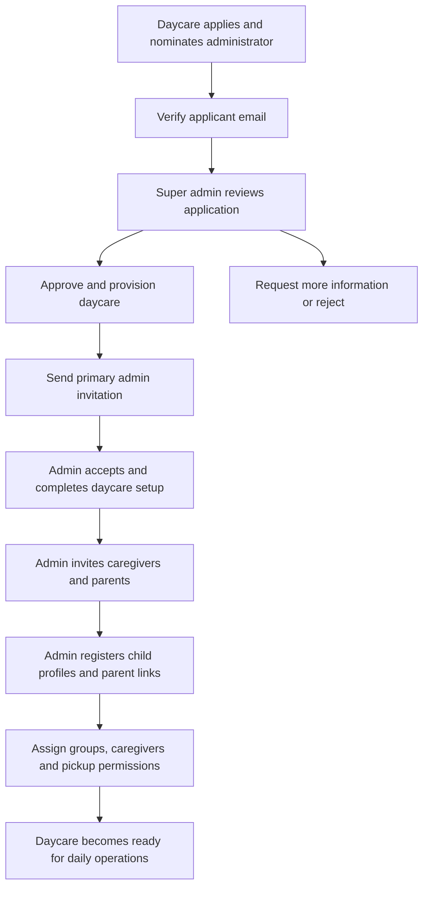
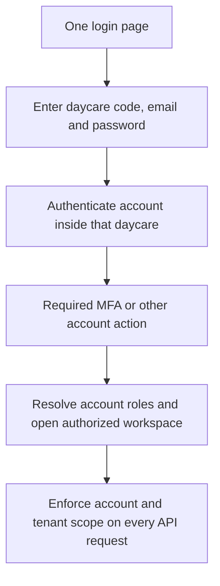

# Ankelba multi-tenant SaaS blueprint

Date: 15 October 2026. Status: proposed architecture and implementation plan; application code has not been changed for this plan. Revised to use separate daycare accounts following the user's latest direction.

## 1. Confirmed product decisions

- Ankelba operates one platform serving independent daycare organizations. Each daycare is a tenant.
- A platform super administrator manages daycare applications, access, setup, governance and operational visibility.
- A daycare applies and nominates one person as its initial primary administrator. Approval leads to an administrator invitation.
- That administrator creates caregiver and parent accounts within that daycare, registers child profiles and links each child to the appropriate parent accounts.
- Children have profiles and enrollment records; they do not need login credentials.
- All adult users enter through one login experience. Daycare users provide a daycare code, email and password; the server authenticates the account within that daycare and resolves its roles.
- Each daycare has independent accounts. A person with children at two daycares has two separate accounts, potentially using the same email, with independently managed credentials, recovery, status and records. This supersedes the earlier shared-identity/membership proposal.
- Payments are deferred. The immediate scope is working SaaS functionality. Do not build subscription checkout, invoices, revenue charts or payment-driven access restrictions in this phase.
- Existing attendance, reporting, communication, pickup and other daycare workflows continue within the selected tenant and permission scope.

The designs below are project-specific recommendations. Linked research explains supporting principles; it is not evidence that the proposed functionality already exists.

## 2. Recommended product structure

Keep the current Express, PostgreSQL and Expo/React stack. Organize the application into clear modules with separately authorized platform and daycare APIs. Begin with a shared database and schema, explicit tenant constraints and PostgreSQL row-level security. Add a background worker for invitations and other retried jobs.

| Surface | Responsibility | Main users |
| --- | --- | --- |
| Public website | Explain Ankelba, accept daycare applications, show an authenticated application-status flow | Prospective daycares |
| Shared login experience | Tenant-specific invitations, credentials, recovery, MFA and sessions; separate platform sign-in context | Adult account holders |
| Platform administration | Approvals, tenant lifecycle, primary administrators, auditing and operational diagnostics | Platform administrators |
| Daycare administration | Staff/parent access, child enrollment, assignments, local settings and operations | Daycare administrators |
| Caregiver workspace | Assigned children, reporting, messages and explicitly assigned desk duty | Caregivers |
| Parent experience | Linked children, reports, messages, events and permitted profile contributions | Parents |

Microsoft describes platform-wide onboarding and maintenance as control-plane responsibilities. This is a useful boundary for the new super-admin workspace. Initially the modules can share a deployable application, with explicit permissions and a restricted platform data-access path; this accepts a larger shared failure boundary than separate infrastructure. Revisit physical separation when the risk or operating scale justifies it. [Microsoft control-plane guidance](https://learn.microsoft.com/en-us/azure/architecture/guide/multitenant/considerations/control-planes)

### Architecture choices and trade-offs

| Decision | Proposed choice | Trade-off and revisit trigger |
| --- | --- | --- |
| Application architecture | One modular backend, shared components, separate API namespaces and policies | Easier migration and operation for this team; isolate services when measured workload or deployment needs justify it |
| Data tenancy | Shared PostgreSQL schema with mandatory tenant ownership and RLS | Efficient onboarding and schema changes; a missed policy has broad impact, so isolation tests are a release gate. Revisit dedicated databases for contractual isolation or demonstrated resource contention |
| Accounts | Independent daycare-scoped accounts; separately scoped platform accounts | Matches the user's latest direction; people using two centers manage two sign-ins, with daycare context required to disambiguate the same email |
| Account setup | Invitations after approval and admin provisioning | Adds delivery/retry handling; avoids distributing shared or permanent passwords |
| Platform visibility | Organization metadata, aggregates and operational events by default | Detailed private child data is accessed only through an explicit support permission, when needed |
| Billing | Deferred | No pretend revenue, billing enforcement or dependence on a gateway during functional rollout |

## 3. End-to-end setup flow

1. **Application:** collect center identity, contacts, address, relevant registration details and the nominated primary administrator. Show an application reference. Verify the applicant's email before progressing review.
2. **Review:** super admin can approve, reject or request information. Decisions record the actor, timestamp and reason. Do not represent a submitted registration number as independently verified unless it was actually checked.
3. **Provisioning:** create the tenant, its defaults, primary-admin account, audit event and invitation job through a retry-safe workflow. Repeating approval must not create duplicate tenants or repeatedly reset existing settings.
4. **Invitation:** send a daycare-bound account-activation link to the nominated administrator. New accounts set a password. An existing account at another daycare is separate and cannot activate this account through its existing session. Resolve duplicate invitations only within the intended daycare.
5. **Setup:** guide the administrator through center details, timezone, opening hours, groups, caregiver invitations, parent invitations, child profiles and assignments. Save progress and permit resuming.
6. **Enrollment:** the administrator creates a child and links one or more parent accounts in the same daycare. A child may be prepared while a parent's invitation is pending. Parents see only authorized linked profiles after their daycare account is activated.
7. **Operation:** caregivers see assigned children; temporary front-desk duty adds its defined scope. Parents see their linked children. Daycare administrators manage their center.

Invitations need explicit queued, sent, failed, accepted, expired and revoked states. Delivery failure should show a retry action and must not undo a successful approval. Store token hashes, expire invitations, consume each token once and invalidate older links when reissuing. These invitation controls adapt OWASP's recommendations for secure account-recovery tokens. [OWASP account-recovery guidance](https://cheatsheetseries.owasp.org/cheatsheets/Forgot_Password_Cheat_Sheet.html)

There should be one active primary administrator per daycare initially. A verified transfer activates the replacement before removing the previous primary administrator. Additional named administrator accounts can be added when required; credentials are never shared.

## 4. Separate daycare accounts and unified login

### Proposed core records

| Record | Purpose |
| --- | --- |
| `users` | Daycare-scoped account with non-null daycare ID, normalized email, password hash, status and verification state; email unique within each daycare |
| `daycares` | Tenant identity, organization details, operational status, unique public login code and primary-admin account |
| `user_roles` | Roles granted to an account within its daycare; may support a person who is both a caregiver and a parent at that center |
| `platform_users`, `platform_role_assignments` | Separately scoped platform accounts and privileges; never inferred from a daycare account's email |
| `daycare_applications` | Review status, applicant, nominated admin, information requests and decisions |
| `invitations` | Target email, tenant, intended role, token hash, expiry and acceptance state |
| `sessions` | Revocable sessions bound to an account ID, account kind and daycare where applicable |
| `children`, `guardian_links` | Tenant-owned child records and parent-account relationships; pickup permission is separate |
| `tenant_settings`, `tenant_features` | Center configuration and explicitly enabled capabilities |
| `audit_events`, `outbox_jobs` | Durable action history and retryable work |

Keep daycare accounts independent. Replace global email uniqueness with uniqueness on `(daycare_id, normalized_email)` after verifying existing data. A daycare administrator manages only that daycare's accounts and may initiate their secure recovery flows. Account changes, password resets and deactivation never propagate to another daycare's account with the same email. Children attending two centers have separate local enrollment/profile records without automatic merging.

### Login behavior

Suggested routes are `/login`, `/accept-invitation`, `/super-admin/overview`, `/admin/dashboard`, `/staff/today` and `/app/home`. Keep one sign-in component and one session layer above all surfaces. Web and native can adapt the same flow to their layouts. A daycare invitation or daycare-specific link may prefill the public daycare code. Platform administrators use a distinct platform sign-in context on the same page, authenticated against platform accounts.

- Authenticate using daycare context and email together. Email alone is ambiguous when the same address has accounts at two daycares. A daycare code is public routing information, never proof of authorization.
- Resolve roles from the authenticated daycare account. If an account has more than one role within that daycare, offer an authorized role/workspace choice.
- Display the signed-in center's name and logo throughout the workspace. Role selection changes the workspace, never grants a new role.
- Bind each session to the authenticated account and daycare. Supplying another daycare ID through a URL, header or request body cannot retarget that session.
- Pending, inactive, revoked or suspended accounts cannot use normal protected APIs. Recheck live account and tenant state rather than trusting long-lived role claims alone.
- Suspension of Daycare A blocks its normal protected requests even with an already issued session; a separate active Daycare B account remains usable.
- Moving to another daycare requires signing into that daycare's separate account. Cancel in-flight loads, clear tenant/child data and reject stale responses during account changes.
- Scope password recovery and invitations to the daycare/account, including when the same email appears at another center. Do not reveal accounts at other daycares.
- Define tab/session handling explicitly so signing into one daycare cannot silently retarget another tab's writes. Validate the displayed account scope against the server before writes and test stale sessions.
- Use secure browser sessions with CSRF protection for cookie-authenticated writes and secure native token storage. Password reset and security actions revoke relevant sessions. Require MFA for privileged accounts before live rollout.

## 5. Tenant isolation and authorization

The authorization decision combines the daycare account's status and tenant binding, daycare status, role permission, record ownership and any linked-child, group or duty restriction. Super-admin platform access is a separate policy path; it must not be a blanket bypass added to every daycare route.

AWS explicitly distinguishes authentication from tenant isolation. OWASP recommends denying ungranted access and validating authorization on every request. The project needs both tenant checks and business permissions. [AWS isolation fundamentals](https://docs.aws.amazon.com/whitepapers/latest/saas-architecture-fundamentals/tenant-isolation.html), [OWASP authorization](https://cheatsheetseries.owasp.org/cheatsheets/Authorization_Cheat_Sheet.html)

Required implementation rules:

- Classify every table as platform/global, tenant-owned or a dependent record with a mandatory tenant ownership path. Review every route, background job, export and search query against that map.
- Tenant-owned operational records must have a non-null daycare ID. Records such as care instructions or meal rows must have an enforced ownership path; do not leave them accessible through an unscoped child/report ID.
- Validate tenant equality for every relationship. A Daycare A child cannot reference Daycare B's group, caregiver, parent account or order. Use composite tenant foreign keys or equivalent database-enforced constraints where appropriate.
- Tenant repositories require a validated context and scope reads, inserts, updates, deletes, joins and counts. Missing context fails closed, rather than meaning all daycares.
- Add RLS to tenant-owned tables and cover dependent tables. Use a runtime database role without superuser, table-owner or `BYPASSRLS` privileges. Use a separate migration owner and a narrowly scoped platform access path.
- Set database tenant context transaction-locally and run all queries in that transaction on the same checked-out connection. Test connection reuse across tenants and absence of tenant context.
- Protect files, signed download URLs, exports, notifications, AI context, jobs and caches with the same tenant and user scope.
- Apply per-user and per-tenant resource limits so one center's exports, uploads or AI usage cannot consume the whole system.
- Parent linkage is distinct from pickup authorization. Parents may contribute permitted care/contact information, while enrollment, group assignment and pickup approval remain administrator-controlled.

PostgreSQL RLS can restrict reads and writes, but superusers and `BYPASSRLS` roles bypass it, and table owners normally bypass it too. Connection-role configuration and tests are part of this decision. [PostgreSQL row-security documentation](https://www.postgresql.org/docs/current/ddl-rowsecurity.html)

Cache keys and stored files need tenant-aware separation, and authorization must happen before returning protected cached data. Resource budgeting also prevents one tenant from degrading others. [OWASP multi-tenant security](https://cheatsheetseries.owasp.org/cheatsheets/Multi_Tenant_Security_Cheat_Sheet.html), [AWS noisy-neighbor guidance](https://docs.aws.amazon.com/wellarchitected/latest/saas-lens/noisy-neighbor.html)

## 6. Super-admin workspace: proposed information architecture

Build a routed desktop workspace with a persistent sidebar, page headers, breadcrumbs, search, filters and detail pages. Keep the Ankelba identity, navy and cream palette, with restrained pastels for meaningful statuses. Give operational tables enough width and use accessible typography, keyboard navigation and clear focus states.

| Area and proposed route | Content and meaningful actions | Delivery |
| --- | --- | --- |
| Overview `/super-admin/overview` | Active/pending/suspended centers, onboarding progress, usage trends, outstanding decisions and actionable failures; show metric date ranges and freshness | First functional release |
| Applications `/super-admin/applications` | Review queue, application details, nominated admin, requests for information, decision history, approve/reject with reason | First functional release |
| Daycares `/super-admin/daycares` | Searchable, paginated directory with status, primary admin, setup progress, account counts and last meaningful activity | First functional release |
| Daycare detail `/super-admin/daycares/:id` | Organization, administrators, setup checklist, permissions/features, usage, invitations, delivery failures, tenant audit and lifecycle history | First functional release |
| Administrators `/super-admin/administrators` | Primary-admin invitations, acceptance/MFA state, replacement workflow, local suspension, recovery initiation and session revocation | First functional release |
| Audit `/super-admin/audit` | Filter by actor, daycare, action, target, outcome and date; inspect reasons and approved sanitized changes; export only with permission | First functional release |
| Operations `/super-admin/operations` | Service readiness, database connectivity, job backlog, invitation failures, backup freshness and actionable incidents; only measured states | Core diagnostics first, deeper tooling later |
| Settings `/super-admin/settings` | Onboarding defaults, permitted feature configuration, invitation lifetime, notification templates and documented configuration changes | Essentials first |
| Platform access `/super-admin/access` | Named platform operators, MFA, sessions and platform permissions; maintain a controlled recovery procedure | Essentials before live use |
| Support `/super-admin/support` | Tenant-linked cases, incident context, permitted diagnostics and time-limited support access | After core setup and operations |
| Subscriptions and billing | Reserved future module, separate from parent store payments | Deferred by user |

### Daycare detail page

Use a header with organization name, status, primary administrator, setup progress, created date and last activity. Tabs can expose Overview, Administrators, Setup, Features, Usage, Activity and Support. Link out to filtered invitation/audit lists to avoid duplicating large interfaces.

Examples of useful actions are request information, approve application, resend an admin invitation, replace the primary administrator, suspend/reactivate the daycare with a reason, edit allowed configuration and open relevant operational history. Consequential actions show scope and impact and record the decision.

Overview cards should lead to the relevant queue. A failed invitation card should open that invitation with a retry action; a setup-incomplete row should open the missing setup steps. Do not add fabricated revenue, unverifiable uptime or decorative charts with no operational purpose.

For large directories use server-side search, sorting and pagination, with URL-persisted filters and explicit empty/error/loading states. Carbon documents established table controls for search, filters, pagination and row actions; adapt these interactions to Ankelba's visual system. [Carbon data-table guidance](https://www.carbondesignsystem.com/building-blocks/core/components/data-table/guidelines)

### Meaning of 360-degree visibility

Give the platform administrator a complete view of organizations, access, setup, service health and relevant action history. Routine pages use aggregate operational information. Private chats, health details and biometric references are outside ordinary platform browsing. If diagnostic access to private records becomes necessary, require a named operator, permitted tenant/data scope, reason, expiry and audit event, with appropriate tenant visibility. Begin without user impersonation.

## 7. Lifecycle, safety and operational quality

Keep separate states for separate processes:

| Process | Example states |
| --- | --- |
| Daycare application | Submitted, awaiting information, under review, approved, rejected |
| Tenant operations | Provisioning, active, suspended, archived |
| Daycare account | Invited, active, inactive, suspended, revoked |
| Invitation delivery | Queued, sent, failed |
| Invitation validity | Pending, accepted, expired, revoked |
| Setup readiness | Not started, in progress, ready |

Transitions must be explicit, validated and audited. Repeating an approval or invitation acceptance should be safe. Stale administrator actions should return a clear conflict instead of overwriting a newer decision. Require a reason for rejection, suspension, administrator replacement and sensitive configuration changes.

Suspension and offboarding are different workflows. Suspension preserves records. Archival/export/deletion require deliberate policy and authorization; no ordinary button should directly cascade-delete an entire daycare. Define how staff handle an in-progress pickup or an emergency during an outage or security suspension through a documented, authorized continuity process. Payments and automatic subscription expiry are outside this phase.

Professional release requirements include:

- A durable invitation/outbox worker with bounded retries, deduplication, failed-job visibility and safe manual retry.
- Structured request logs correlated with request IDs and tenant context, separate from the audit trail. Add measured latency, errors and job outcomes; deeper tracing can follow the first diagnostics.
- Audit records for who acted, tenant, action, target, outcome, timestamp and reason, plus approved non-sensitive changes. Restrict audit alteration and capture denied sensitive actions.
- Logs that exclude passwords, invitation/reset tokens, access tokens, raw biometric data and sensitive child content. [OWASP logging guidance](https://cheatsheetseries.owasp.org/cheatsheets/Logging_Cheat_Sheet.html)
- Signals that connect failed user actions to service behavior. OpenTelemetry provides instrumentation for logs, metrics and traces; it still needs an actual telemetry backend. [OpenTelemetry overview](https://opentelemetry.io/docs/what-is-opentelemetry/)
- Separate development, staging and live environments, HTTPS, managed secrets, secure sessions, dependency checks and a repeatable deployment/rollback process.
- Backups with a demonstrated restore, including a tested procedure for recovering one tenant from a shared backup without exposing others. Set recovery and availability targets from actual operational needs.
- Tenant-aware file access, documented retention/export/deletion, minimal sensitive-data collection and clear controls for any external AI feature.
- Loading, empty, permission-denied, expired-invitation and recoverable-error states that preserve entered work. No simulated success in authenticated operational flows.

## 8. Findings in the current code

These are static inspection findings, not production exploit verification. Backend integration checks in the earlier review were blocked by local socket permissions.

| Current source | Finding | Planned consequence |
| --- | --- | --- |
| `backend/src/modules/users/users.service.js` | List, detail and update queries have no tenant predicate; user creation does not assign a daycare | Enforce daycare-scoped account administration and consistently scoped data access |
| `backend/src/modules/auth/auth.service.js` | Public parent registration creates an active parent, an automatic child with placeholder identity data and a pickup-authorized link; new rows omit daycare ID | Remove public parent provisioning; use admin invitations and real administrator-created enrollment/link records |
| `backend/src/modules/children/children.parent.service.js` | Parent profile writes include group assignment | Restrict parent-editable fields; groups and enrollment are daycare-admin decisions |
| `backend/src/middleware/tenant.js` | Tenant enforcement exists, but search found no application imports/usages of `enforceTenant` | Make validated context and tenant-state enforcement mandatory on protected operational paths |
| `backend/src/middleware/auth.js` | Loads live daycare state but currently proceeds after checking only the user's active status | Enforce current account status, session tenant binding and tenant state on every protected request |
| `backend/src/db/migrations/013_multi_tenant_saas.js` | Tenant columns remain nullable, existing null data is assigned to a default daycare, and a fixed platform credential is seeded | Use verified forward migrations, non-null ownership rules and secure operator bootstrap |
| `frontend/src/portal/SuperAdmin.web.tsx` | A separate embedded login with prefilled platform credentials and one primary management screen | Remove credential defaults and embedded sign-in; implement shared authentication and routed platform modules |
| `frontend/App.tsx` | The main auth provider sits inside the parent branch, beneath `PortalGate` | Move identity/session ownership above role-specific surfaces |
| `frontend/src/portal/PortalGate.web.tsx` | Routes select separate surfaces based on path | Retain path routing but add shared session guards and authorized workspace resolution |
| `backend/src/modules/saas/saas.service.js` | Existing approval/governance foundation; some actions lack transition guards and rejection reasons are not persisted | Preserve useful logic while adding explicit lifecycle transitions, durable reasons and invitations |

The current stack and feature modules are useful foundations. The missing work is a consistent model across the entire application, rather than a new frontend screen alone.

## 9. Migration approach

1. Inventory actual applied migrations, tables, routes and ownership relationships in the development database before changing schema. Take a recoverable checkpoint.
2. Establish daycare-scoped account uniqueness, role assignments and separately scoped platform accounts through new forward migrations. Backfill from verified current users; preserve identifiers and audit actor traceability. Never split or copy an existing account into another daycare without verified provisioning.
3. Reconcile child, parent, group and caregiver tenancy from verified relationships. Flag orphaned or ambiguous records for explicit resolution; do not automatically place all missing data into Daycare 1.
4. Update login, recovery, invitations and user management to resolve accounts within a daycare. Keep one authoritative account/role model with no cross-daycare account lookup or linkage based only on email.
5. Validate data, add tenant constraints/RLS and prove rejection of missing/wrong context. Use realistic application database permissions in staging.
6. Replace signup and all embedded login paths, then exercise the complete setup flow. Remove production mock fallbacks and insecure credential defaults.
7. Verify fresh installation and upgrade of an existing database, then remove obsolete global uniqueness rules and any temporary compatibility paths only after all consumers are migrated.

## 10. Ordered execution plan

- [ ] **Define contracts and migration inventory:** record permission matrix, tenant ownership map, lifecycle transitions, shared-session contract and the existing-data migration path. Exit: every existing module has an explicit scope.
- [ ] **Establish separate daycare accounts:** enforce tenant-local email uniqueness, scoped roles, platform account separation and primary-admin ownership. Exit: the same email can have independent accounts at two daycares, and changing one account never changes the other.
- [ ] **Enforce isolation:** migrate all protected queries, relationships, file/job/cache boundaries and database policies. Exit: automated cross-tenant read/write tests pass using the restricted runtime database role.
- [ ] **Implement application approval and invitations:** add applicant verification, transition guards, durable audit/outbox writes, acceptance, expiry and retry. Exit: repeated actions and delivery failures cannot produce duplicate tenants or privileges.
- [ ] **Unify authentication and workspace routing:** use one login page with daycare code, email and password, separate platform sign-in context, MFA for privileged users and guarded sessions. Exit: authentication/recovery targets the correct account, and refresh, deep links or another tab cannot change the tenant scope of a write.
- [ ] **Complete daycare setup:** implement the resumable setup checklist, caregiver/parent invitations, child enrollment, parent links and assignments. Exit: a new approved daycare reaches daily operations without database scripts.
- [ ] **Build the routed super-admin workspace:** deliver overview, application queue, daycare detail, administrator management and audit around live APIs. Exit: each displayed action completes a real authorized workflow with an auditable outcome.
- [ ] **Add operational diagnostics and recovery:** expose measured service/job/invitation state, safe retries, essential configuration, backups and documented continuity. Exit: operators can diagnose and recover the agreed failure cases.
- [ ] **Validate complete journeys and enforce CI:** test two tenants with the same parent email but independent accounts, invitation/recovery isolation, stale actions, suspended accounts, direct URLs, pickup rules and existing core features. Exit: frontend typecheck, relevant automated suites and staging migration checks pass.
- [ ] **Run a staged pilot:** rehearse restore and deployment rollback; demonstrate the full lifecycle using two isolated daycares and realistic records. Exit: documented acceptance evidence and remaining limitations before admitting real customers.

Detailed support tooling, advanced analytics, custom domains, multi-branch organizations, SSO, dedicated tenant infrastructure and payments follow the functional pilot when justified. Their absence must not weaken the core tenant boundary.

## 11. Acceptance demonstration

The project should demonstrate these outcomes end to end:

1. Center A applies, verifies its contact and is approved. Its administrator accepts an invitation and completes setup.
2. Center B completes the same flow independently. Each center has its own caregivers, parents, children, groups and settings.
3. One person has independent accounts at both centers, optionally with the same email. Each daycare code/email/password sign-in opens only that account's linked children or assigned work; there is no automatic account linking or merging.
4. Center A's administrator cannot list, link, update, export, message or download Center B's records by changing IDs or request parameters.
5. Deactivating that person's Center A account immediately removes Center A access while their Center B account remains available. Password recovery or changing profile information in Center A does not modify Center B's account.
6. Repeated approval, repeated invitation acceptance, expired links and delivery failures are handled safely with clear recovery actions.
7. Replacing a primary administrator preserves administrative continuity and records the change.
8. Suspended tenants cannot use normal protected APIs through existing sessions; operational continuity follows the documented process.
9. The super admin can trace an application decision, failed invitation and administrator replacement through relevant audit and diagnostic screens.
10. Existing reporting, attendance and pickup rules still work, including linked-parent access, duty restrictions and verification before checkout.

This is the initial definition of a professional functional SaaS release. Targets for performance, recovery and pilot scale should be agreed before the staged rollout and measured rather than implied by dashboard labels.
